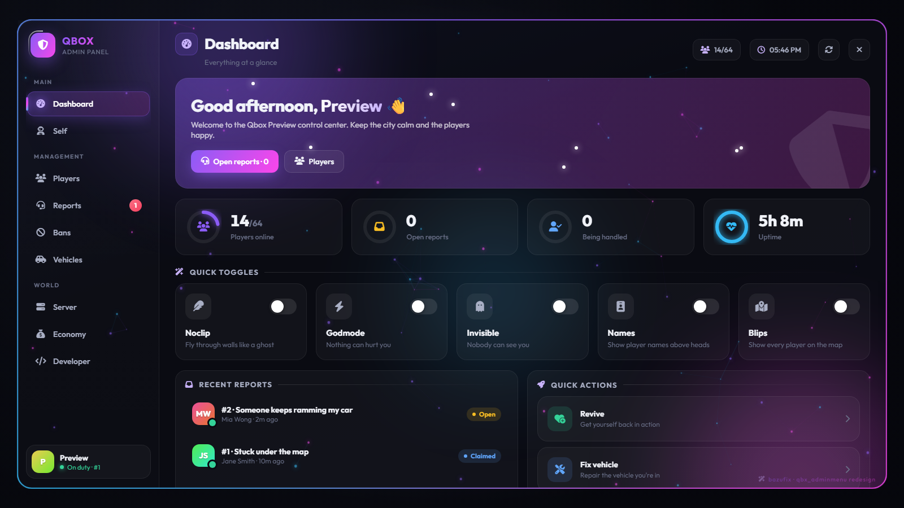
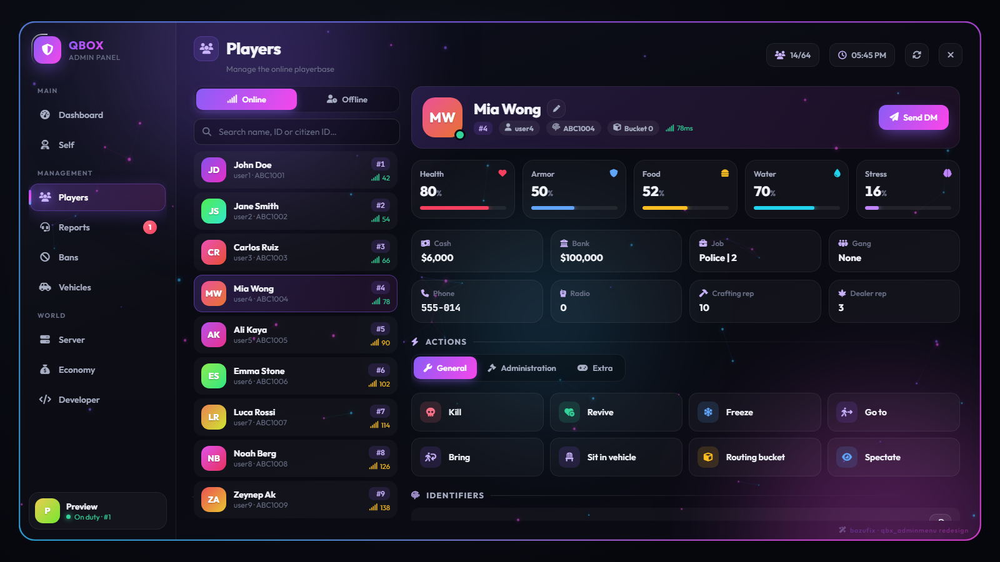
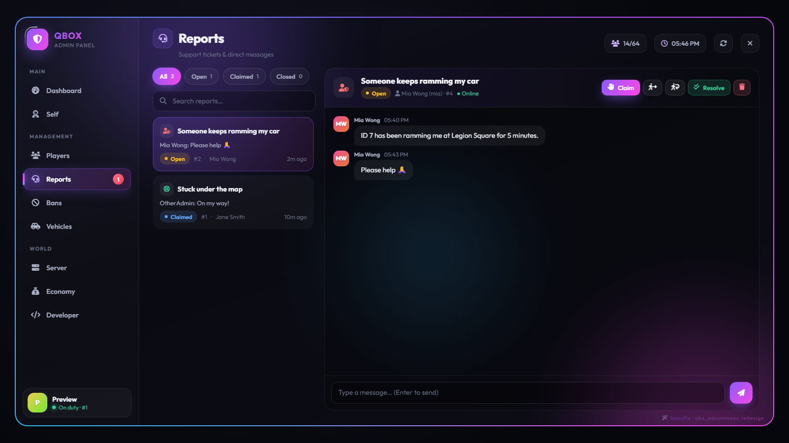
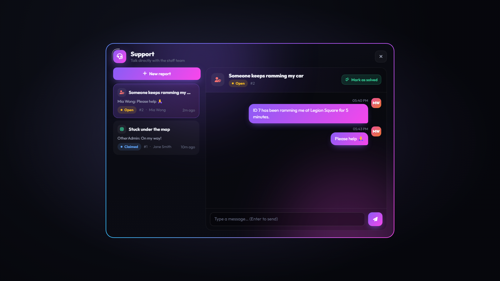
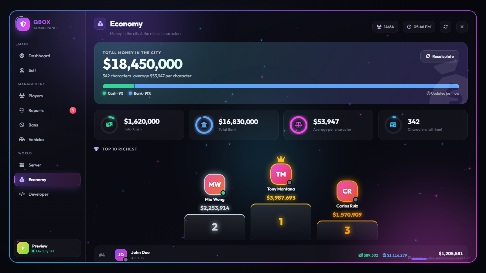
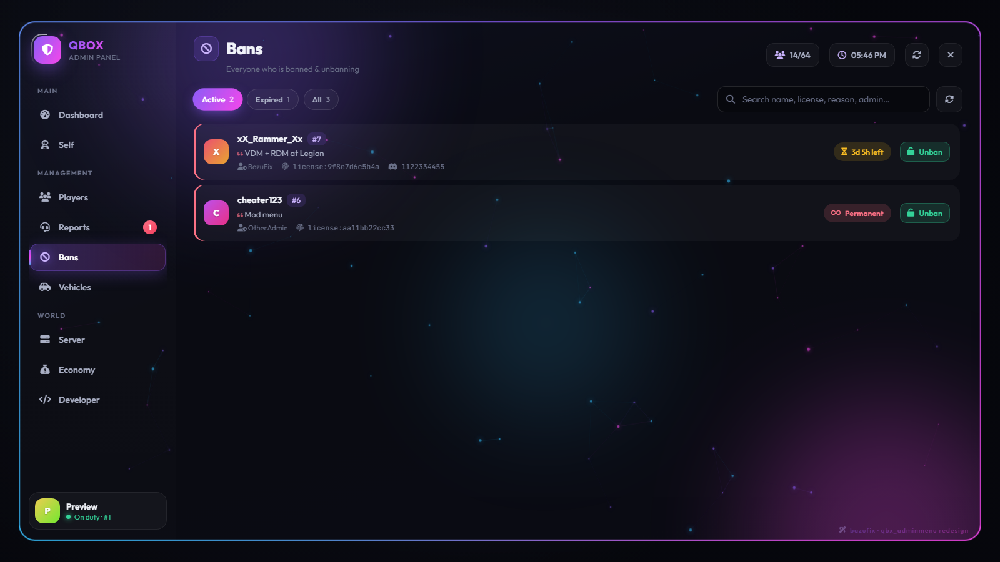
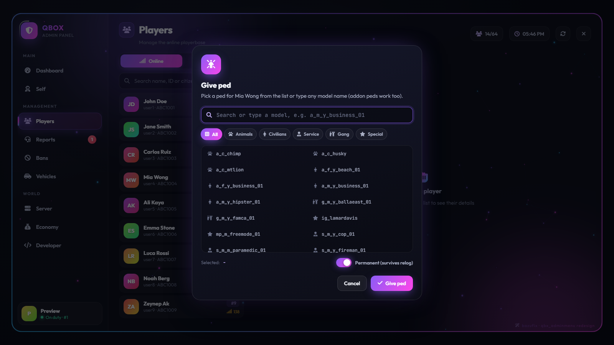
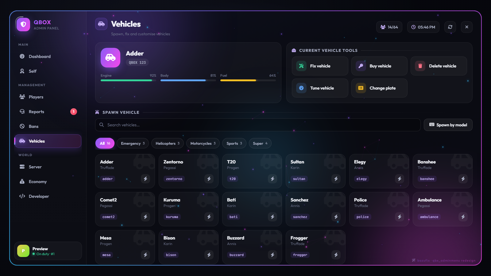
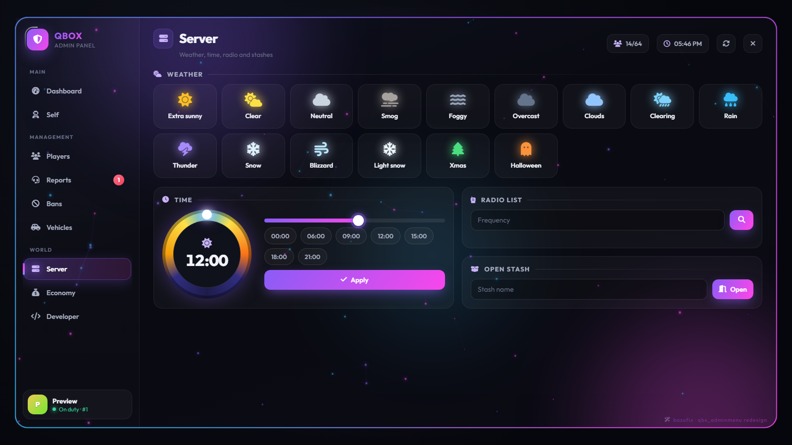

# qbx_adminmenu — Redesign

💬 **Support, updates & more scripts on our Discord:** https://discord.gg/EzCWKFVhRw

**[EN](#en) | [TR](#tr)**

A complete NUI redesign of [Qbox-project/qbx_adminmenu](https://github.com/Qbox-project/qbx_adminmenu): a colourful, animated admin panel with a built-in report & DM system, ban list, character kill, offline player management, economy overview and more.

> 🛒 **More FiveM scripts:** [**Bazu Store**](https://bazustore.tebex.io) — premium & free resources for Qbox / QBCore.

### 🎬 Preview

---

## EN

### Features

- **Centered panel with sidebar navigation** — animated gradient border, particle background, page transitions, sounds, confetti. Accent colour is configurable, every gradient is derived from it.
- **Reports & DMs** — players open a support window with `/report`, pick a category and chat live with staff (typing indicator, claim / unclaim, go to / bring, resolve, reopen, 1–5 star rating). Staff can start a DM with any online player.
- **Players** — live list with search; health / armour / food / water / stress; click-to-edit cash, bank, job, gang, phone, radio, reputation; kill, revive, freeze, go to, bring, sit in vehicle, routing bucket, spectate, kick, ban (temporary or permanent), permissions, inventory, clothing, give item, mute, **give ped**, **character kill**.
- **Offline players** — search every character in the database by name, citizen ID or license; edit cash / bank, ban by license or character-kill while they are offline.
- **Ban list** — active / expired filter, search, remaining time, one-click unban.
- **Give ped** — searchable list read from `illenium-appearance`, or type any (addon) model; optional permanent save to illenium-appearance.
- **Economy** — total money in the city (cash + bank of every character), averages and a top-10 richest podium.
- **Vehicles** — current vehicle status, fix / buy / delete / tune / plate, full catalogue with categories and search.
- **Server** — weather, time dial, radio frequency list, open stash.
- **Developer** — live coordinates, one-click vec2 / vec3 / vec4 / heading copy, coordinate & vehicle info overlays.
- **Self** — noclip, godmode, invisible, names, blips, vehicle godmode, infinite ammo, ped model, give weapons.
- Fully permission based: every page and action is checked on the server and hidden in the UI when not allowed.
- English & Turkish translations included (other languages fall back to English).

### Screenshots

| | |
|---|---|
|  |  |
|  |  |
|  |  |
|  |  |

### Requirements

- [qbx_core](https://github.com/Qbox-project/qbx_core)
- [ox_lib](https://github.com/overextended/ox_lib)
- [oxmysql](https://github.com/overextended/oxmysql)
- Optional: `ox_inventory`, `pma-voice`, `qbx_vehiclekeys`, `qbx_customs`, `illenium-appearance`

### Installation

1. Remove (or rename) the original `qbx_adminmenu`.
2. Put this resource in your resources folder **named `qbx_adminmenu`**.
3. `ensure qbx_adminmenu` after its dependencies (it replaces the original, nothing else to change).
4. Adjust the config files (see below) and restart.

### Configuration

| File | What |
|---|---|
| `config/client.lua` | Accent colour, brand name / subtitle / logo URL, open keys, sounds, background effects, report categories |
| `config/server.lua` | Permissions per action, report limits, economy settings, character kill message, give ped options, weapon lists |
| `config/shared.lua` | Force a language (`'en'`, `'tr'`, …) or `false` to follow `ox:locale` |

Permissions use ACE groups the same way the original resource does (`mod`, `admin`, `god`). New permissions added by this redesign: `economy`, `characterKill`, `bans`, `offlinePlayers`, `givePed` (all `admin` by default).

### Commands

| Command | Who | |
|---|---|---|
| `/admin` (default key **F10**) | staff | Open the admin panel |
| `/report` | everyone | Open the support window |
| `/report <message>` | everyone | Send a quick report |
| `/noclip` `/names` `/blips` `/setmodel` `/admincar` `/vec2` `/vec3` `/vec4` `/heading` | staff | Same as the original resource |

### Preview without the game

Serve the resource folder with any static web server and open `web/index.html` in a browser — it runs with demo data. Useful parameters: `?page=players`, `?page=reports`, `?mode=player`.

### Notes

- Reports are kept in memory; they are cleared when the server restarts.
- Spectate is client side and available to everyone who can open the panel.
- Fonts and icons are loaded from Google Fonts / cdnjs.

### Credits & License

Based on [Qbox-project/qbx_adminmenu](https://github.com/Qbox-project/qbx_adminmenu) (GPL-3.0). The UI was rewritten from scratch as an NUI panel and the report, ban list, character kill, offline player, economy and give ped systems were added. The original admin logic (noclip, blips/names, player options, vehicle and server options) is kept.

Licensed under the **GNU General Public License v3.0**, the same license as the original — see [LICENSE](LICENSE). You may use, modify and share it (also commercially), as long as any distributed version stays GPL-3.0 with its source code available.

Redesign by **[BazuFix](https://github.com/BazuFix)** · 💬 [**Discord**](https://discord.gg/EzCWKFVhRw) · 🛒 [**Bazu Store**](https://bazustore.tebex.io)

---

## TR

[Qbox-project/qbx_adminmenu](https://github.com/Qbox-project/qbx_adminmenu) için baştan yazılmış, renkli ve animasyonlu bir NUI admin paneli. İçinde rapor & DM sistemi, ban listesi, CK, çevrimdışı oyuncu yönetimi, ekonomi ekranı ve daha fazlası var.

> 💬 **Destek, güncellemeler ve diğer scriptler Discord sunucumuzda:** https://discord.gg/EzCWKFVhRw
>
> 🎬 **Tanıtım videosu:** https://www.youtube.com/watch?v=HLpYnjaFu8I
>
> 🛒 **Daha fazla FiveM scripti:** [**Bazu Store**](https://bazustore.tebex.io) — Qbox / QBCore için ücretli ve ücretsiz kaynaklar.

### Özellikler

- **Ortada, yan menülü panel** — animasyonlu gradient çerçeve, parçacıklı arka plan, sayfa geçişleri, sesler, konfeti. Vurgu rengi configten ayarlanıyor, tüm gradientler ondan türetiliyor.
- **Rapor & DM** — oyuncular `/report` ile destek penceresini açıp kategori seçiyor ve yetkiliyle canlı yazışıyor ("yazıyor..." göstergesi, üstlen / bırak, yanına git / çek, çözüldü, yeniden aç, 1–5 yıldız puan). Yetkililer çevrimiçi herhangi bir oyuncuya DM başlatabiliyor.
- **Oyuncular** — aramalı canlı liste; can / zırh / yemek / su / stres; tıklayarak nakit, banka, meslek, çete, telefon, telsiz, itibar düzenleme; öldür, canlandır, dondur, yanına git, çek, araca bin, routing bucket, izle, at, banla (süreli veya kalıcı), yetki, envanter, kıyafet, eşya ver, sustur, **ped ver**, **CK at**.
- **Çevrimdışı oyuncular** — veritabanındaki tüm karakterlerde isim, citizen ID veya license ile arama; oyuncu çevrimdışıyken nakit / banka düzenleme, license ile ban, CK.
- **Ban listesi** — aktif / süresi dolmuş filtresi, arama, kalan süre, tek tıkla ban kaldırma.
- **Ped ver** — `illenium-appearance`'tan okunan aramalı liste ya da elle model (addon dahil); istenirse illenium-appearance'a kalıcı kayıt.
- **Ekonomi** — şehirdeki toplam para (tüm karakterlerin nakit + bankası), ortalamalar ve en zengin 10 kişilik podyum.
- **Araçlar** — mevcut aracın durumu, tamir / satın al / sil / modifiye / plaka, kategorili ve aramalı tam katalog.
- **Sunucu** — hava durumu, saat kadranı, telsiz frekans listesi, depo açma.
- **Geliştirici** — canlı koordinat, tek tıkla vec2 / vec3 / vec4 / heading kopyalama, ekran üstü koordinat ve araç bilgisi.
- **Kendim** — noclip, ölümsüzlük, görünmezlik, isimler, blipler, araç ölümsüzlüğü, sınırsız mermi, ped modeli, silah verme.
- Tamamen yetki bazlı: her sayfa ve işlem sunucuda kontrol ediliyor, yetki yoksa arayüzde gizleniyor.
- Türkçe ve İngilizce dil dosyaları hazır.

### Gereksinimler

- [qbx_core](https://github.com/Qbox-project/qbx_core), [ox_lib](https://github.com/overextended/ox_lib), [oxmysql](https://github.com/overextended/oxmysql)
- Opsiyonel: `ox_inventory`, `pma-voice`, `qbx_vehiclekeys`, `qbx_customs`, `illenium-appearance`

### Kurulum

1. Orijinal `qbx_adminmenu`'yü kaldırın (ya da adını değiştirin).
2. Bu resource'u **`qbx_adminmenu` adıyla** resources klasörüne koyun.
3. Bağımlılıklardan sonra `ensure qbx_adminmenu` yapın.
4. Config dosyalarını düzenleyip yeniden başlatın. Türkçe için `config/shared.lua` içinde `locale = 'tr'` yapın.

Ayarlar, yetkiler ve komutlar için yukarıdaki İngilizce bölümdeki tablolara bakabilirsiniz.

### Notlar

- Raporlar bellekte tutulur, sunucu yeniden başlayınca silinir.
- İzleme (spectate) istemci tarafındadır, paneli açabilen herkes kullanabilir.

### Lisans

[Qbox-project/qbx_adminmenu](https://github.com/Qbox-project/qbx_adminmenu) (GPL-3.0) tabanlıdır; arayüz NUI olarak baştan yazılmış, rapor, ban listesi, CK, çevrimdışı oyuncu, ekonomi ve ped verme sistemleri eklenmiştir. Orijinalle aynı şekilde **GNU GPL v3.0** ile lisanslıdır: kullanabilir, değiştirebilir ve (ticari olarak da) paylaşabilirsiniz; dağıtılan her sürüm GPL-3.0 kalmalı ve kaynak koduyla birlikte sunulmalıdır.

Redesign: **[BazuFix](https://github.com/BazuFix)** · 💬 [**Discord**](https://discord.gg/EzCWKFVhRw) · 🛒 [**Bazu Store**](https://bazustore.tebex.io)
